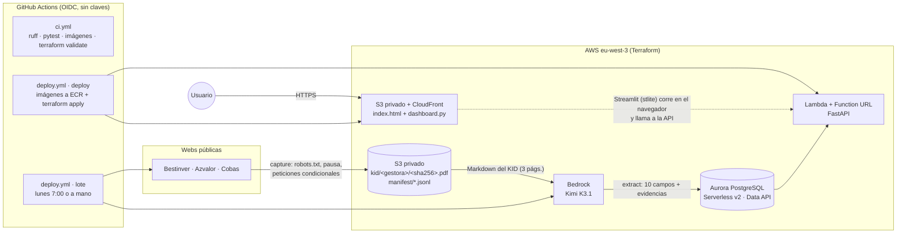

<div align="center">

# Fund KID Pipeline AWS

**Del KID en PDF al cuadro de mando: pipeline de datos de fondos de inversión en AWS con IA generativa**


Máster MIAX · Módulo Cloud · Práctica B7 · Noviembre 2026<br>
Óscar Romero Quincoces · Fernando Dapena Tauste · Daniel García López

</div>

---

## En marcha

| | URL |
|---|---|
| Aplicación (Streamlit en el navegador, S3 + CloudFront) | WEB_URL |
| API (FastAPI en Lambda) | https://mozsktwrxdyadipvsc3vsvaxni0hawvo.lambda-url.eu-west-3.on.aws/docs |

En AWS hay 68 KID de 3 gestoras, extraídos con Kimi K3.1 y con sus evidencias revisadas. Rutas de la API:
- `/fondos`, con los filtros `gestora`, `sri_min` y `sri_max`.
- `/fondos/{isin}`.
- `/resumen`.
- `/health`.

## Resumen

| | Mínimo del enunciado | Esta solución |
|---|---|---|
| Fuentes y documentos | 2 y 15 | **3 gestoras y 68 KID** (Bestinver 41, Cobas 22, Azvalor 5), con origen y fecha de cada uno |
| Extracción | Bedrock con salida estructurada | Kimi K3.1 con **herramienta estricta** y **evidencia literal por campo**: 170/170 campos correctos en 17 KID revisados a mano y 680/680 evidencias verificadas |
| Base de datos | PostgreSQL sin duplicados | Aurora Serverless v2 con Data API; la identidad de cada documento es el SHA-256 del PDF |
| API y aplicación | Una de cada | FastAPI en Lambda con Function URL y Streamlit ejecutado en el navegador (stlite) desde S3 + CloudFront, ambas públicas y por ~0 $ al mes ([D-4.3](docs/DECISIONES.md)) |
| Infraestructura | Terraform y GitHub Actions | Dos raíces de Terraform, OIDC sin claves, despliegue y lote semanal desde Actions |

**Ampliaciones del enunciado:**
- Comparación de modelos: Kimi frente a Nova frente a reglas ([D-2.2](docs/DECISIONES.md)).
- Precisión medida con KID revisados a mano ([D-2.5](docs/DECISIONES.md)).
- 107 tests, ruff, `terraform validate` y construcción de imágenes en cada push.
- Detección de KID nuevos, cambiados o desaparecidos en cada captura ([D-1.6](docs/DECISIONES.md)).

Todas las decisiones, con su porqué y su evidencia, están en [`docs/DECISIONES.md`](docs/DECISIONES.md).

## El problema

Todo fondo que se vende a minoristas en la UE publica un **KID** (*Key Information Document*): unas tres páginas con
el ISIN, la gestora, el indicador de riesgo (SRI 1-7), el periodo de mantenimiento recomendado y los costes. La
información existe, pero está encerrada en PDF dispersos por la web de cada gestora y con formatos distintos.

Este repositorio la saca de ahí: **captura** los KID de varias gestoras, los guarda en **S3**, extrae sus campos con
un modelo de **Amazon Bedrock con salidas estructuradas**, los carga en **PostgreSQL** sin duplicados y los sirve con
una **API** y una **aplicación web**. Toda la infraestructura se define con **Terraform** y se despliega desde
**GitHub Actions**.

## Enunciado (resumen)

| Fase | Mínimo exigido |
|---|---|
| Captura | KID de al menos **2 fuentes** y **15 documentos**, con origen y fecha de descarga de cada uno |
| Almacenamiento | PDF en Amazon S3 |
| Extracción con IA | Campos del Anexo A con un modelo de Bedrock y **salidas estructuradas** (no "devuelve JSON" y parsear) |
| Base de datos | PostgreSQL en AWS, **sin duplicados** si un documento se procesa dos veces |
| API | API HTTP sobre los datos |
| Visualización | Aplicación web para explorarlos |
| Infraestructura | Terraform desplegado desde GitHub Actions |

**Campos mínimos (Anexo A):** `isin`, `nombre_producto`, `nombre_clase`, `gestora`, `fecha_documento`, `sri`,
`periodo_mantenimiento_anios`, `gastos_corrientes_pct`, `costes_entrada_pct`, `costes_salida_pct`. Si un campo no
aparece en el KID queda a `null`: el modelo no lo inventa.

**Fuentes de los talleres:** Bestinver (dificultad baja), Azvalor (media) y Cobas AM (media-alta).

**Reglas:** sin credenciales en el repositorio, y los datos y documentos solo se exponen a través de la API y la
aplicación.

**Entrega:** el **2/12/2026** por el aula virtual: repositorio (compartido con el profesor) con un README de
arquitectura, decisiones y despliegue, las URL de la aplicación y de la API y los nombres del grupo. Exposición en el
taller 3 con demo en directo.

## Arquitectura



| Capa | Referencia de los talleres | Esta solución | Por qué |
|---|---|---|---|
| Captura | `requests` + BeautifulSoup | Igual, con robots.txt (RFC 9309), pausa por servidor, reintentos y peticiones condicionales | [D-1.1](docs/DECISIONES.md), [D-1.6](docs/DECISIONES.md) |
| Almacenamiento | S3 por fecha | S3 por **SHA-256** del PDF, con manifiesto JSONL por ejecución | Idempotencia e histórico, [D-1.2](docs/DECISIONES.md) |
| Texto | `pymupdf4llm` con OCR | `pymupdf4llm` sin OCR, **solo las 3 páginas del KID** | Los 68 tienen texto; Cobas añade un anexo, [D-2.3](docs/DECISIONES.md) |
| Extracción | LangChain, `json_schema`, Kimi K3.1 | boto3 Converse, **herramienta estricta**, Kimi K3.1, con la alternativa `outputConfig` | [D-2.1](docs/DECISIONES.md), [D-2.2](docs/DECISIONES.md) |
| Control de calidad | Evidencias por campo | Evidencias **verificadas** (aparecen y cuadran), reglas y 17 KID de referencia | [D-2.4](docs/DECISIONES.md), [D-2.5](docs/DECISIONES.md) |
| Base de datos | Aurora Serverless v2 con Data API | Igual, con upsert por SHA-256 y vista `kid_vigente` | [D-3.1](docs/DECISIONES.md) |
| API | FastAPI en Lambda con Function URL | Igual, con imagen de contenedor y Mangum | [D-4.2](docs/DECISIONES.md) |
| Visualización | Streamlit en ECS Express | El mismo Streamlit, **ejecutado en el navegador** (stlite) desde S3 + CloudFront: ~0 $ frente a ~80 $ al mes. ECS Express queda como alternativa apagada | [D-4.1](docs/DECISIONES.md), [D-4.3](docs/DECISIONES.md) |
| Despliegue | Terraform + Actions (OIDC, estado en S3) | Dos raíces (bootstrap local y principal desde Actions), con interruptor de coste | [D-5.1](docs/DECISIONES.md), [D-5.2](docs/DECISIONES.md) |

## Estructura

Tres carpetas, como en los talleres de RL ([D-0.5](docs/DECISIONES.md)): el código, la infraestructura y la
documentación. La lógica vive en un único paquete y el resto son capas finas que la ejecutan o la sirven
([D-0.3](docs/DECISIONES.md)).

```
├── src/                        # todo el código
│   ├── kid_pipeline/           # lógica común: única fuente de verdad
│   │   ├── schema.py           # campos del Anexo A (Pydantic), esquema estricto para Bedrock, ISIN
│   │   ├── capture.py          # sesión educada (User-Agent, robots.txt, pausa) y una fuente por gestora
│   │   ├── storage.py          # S3: kid/<gestora>/<sha256>.pdf con metadatos de origen, y manifiesto JSONL
│   │   ├── texto.py            # PDF -> Markdown de las 3 páginas del KID (pymupdf4llm)
│   │   ├── extract.py          # Bedrock sobre el Markdown: herramienta estricta y evidencia literal por campo
│   │   ├── reglas.py           # extractor por reglas: línea base para evaluar Bedrock
│   │   ├── db.py  schema.sql   # RDS Data API: upsert idempotente; tablas documentos y kid, vista kid_vigente
│   │   └── __init__.py         # Config por variables de entorno
│   ├── pipeline.py             # lote: init-db | capture | extract
│   ├── api.py                  # FastAPI + Mangum en Lambda con Function URL
│   ├── dashboard.py            # Streamlit (en el navegador con stlite, o en ECS Express); solo lee de la API
│   ├── index.html              # la web: carga stlite y monta dashboard.py (S3 + CloudFront)
│   └── test_pipeline.py        # tests sin AWS (clientes falsos)
├── infra/                      # todo el despliegue
│   ├── main.tf  datos.tf  servicios.tf   # proveedor y variables · S3 y Aurora · Lambda, ECR y ECS Express
│   ├── api.Dockerfile  dashboard.Dockerfile
│   └── bootstrap/main.tf       # una vez y en local: bucket del estado, OIDC y rol de GitHub
├── docs/
│   ├── DECISIONES.md           # registro de decisiones D-X.n
│   ├── teoria/                 # síntesis del material de clase
│   └── raw/                    # material de clase (local, no versionado)
└── .github/workflows/          # ci.yml (ruff, pytest, imágenes, terraform validate) · deploy.yml (despliegue y lote)
```

## Puesta en marcha

En Windows (PowerShell), desde la carpeta del proyecto:

```powershell
py -3.13 -m venv .venv
.\.venv\Scripts\python.exe -m pip install -r requirements.txt
.\.venv\Scripts\python.exe -m pytest
```

Captura en local, sin AWS: los PDF y el manifiesto van a `data/`, que no se versiona.

```powershell
.\.venv\Scripts\python.exe src/pipeline.py capture --local      # las tres gestoras (--gestora cobas para una)
.\.venv\Scripts\python.exe src/pipeline.py verificar            # comprobaciones de lo capturado
.\.venv\Scripts\python.exe -m pytest -m red                     # parseo contra las webs reales
```

`capture --dry-run` solo lista los enlaces encontrados, sin descargar nada.

Qué hace la captura ([D-1.4 a D-1.6](docs/DECISIONES.md)):

- **Encuentra el KID por su rótulo**, con las variantes que usan las gestoras («Datos fundamentales», «DFI», «KID»,
  «PRIIP», «DFP», con o sin tildes) y, si el enlace es un icono, por el nombre del fichero. Sigue las fichas de cada
  clase (Bestinver tiene una página por clase) y asigna a cada KID el ISIN y la clase de su bloque solo si no hay duda.
- **Lee cada PDF al descargarlo** y guarda en el manifiesto lo que dice de sí mismo (`isin_pdf`, `paginas`,
  `tipo_documento`). Rechaza lo que no es un KID (otro documento con el mismo rótulo, o con más de 12 páginas).
- **Compara con la captura anterior**: lista los KID nuevos, cambiados (mismo ISIN, otro SHA-256) y desaparecidos, y
  pide cada PDF conocido con `If-None-Match` / `If-Modified-Since` para no volver a bajarlo si no ha cambiado.

Resultado de la captura del 19/11/2026 (el mínimo del enunciado son 2 fuentes y 15 documentos):

| Gestora | Fichas | KID | ISIN de la web en el PDF | ISIN solo en el PDF | Con clase |
|---|---:|---:|---:|---:|---:|
| Bestinver | 42 | 41 | 16 | 25 | 27 |
| Azvalor | 5 | 5 | 5 | 0 | 0 |
| Cobas | 7 | 22 | 22 | 0 | 20 |
| **Total** | **54** | **68** | **43** | **25** | **47** |

Los 68 son KID PRIIPs, sin errores ni duplicados; la segunda captura dio 68 "sin cambios" (304).

`verificar` comprueba la integridad de todo lo guardado y, en lo vigente, que cada PDF sea un KID y que el ISIN, la
clase y la fecha que da la web estén en el PDF, sin ISIN ni clases repetidos.

Del PDF a los datos, también en local (D-2.3 a D-2.5):

```powershell
.\.venv\Scripts\python.exe src/pipeline.py markdown                     # PDF -> Markdown del KID en data/markdown/
.\.venv\Scripts\python.exe src/pipeline.py evaluar                      # extractor por reglas frente a la referencia
.\.venv\Scripts\python.exe src/pipeline.py evaluar --predicciones data/extraccion/<modelo>.jsonl
.\.venv\Scripts\python.exe src/pipeline.py extract --local --modelo global.moonshotai.kimi-k3.1  # Bedrock, tras aws login
```

Resultado con Bedrock (26/11/2026, [D-2.2](docs/DECISIONES.md)): **Kimi K3.1** acierta 170 de 170 campos de la
referencia y sus 680 evidencias aparecen en el KID y cuadran con su valor. Nova 2 Lite, sin modo estricto, se queda en
159 de 170. `extract --local` retoma donde lo dejó: un KID ya extraído no se vuelve a pagar.

Para subir a AWS lo capturado y extraído en local, sin volver a descargar ni a pagar Bedrock, se exportan las salidas de
Terraform como variables de entorno (ver `.env.example`) y se ejecuta:

```powershell
.\.venv\Scripts\python.exe src/pipeline.py init-db
.\.venv\Scripts\python.exe src/pipeline.py cargar --extraccion data/extraccion/global.moonshotai.kimi-k3.1.jsonl
```

`evaluar` compara campo a campo con `data/referencia.json` (17 KID revisados a mano, no versionado):
- **En la referencia:** exactitud por campo y global, nulls acertados, valores inventados u omitidos y la lista de
  discrepancias.
- **En los 68 KID:** el ISIN y la clase frente al manifiesto, y la cobertura por campo.

El JSONL de un modelo lleva una línea por documento (`sha256` y los 10 campos del Anexo A), así que se comparan modelos
sin volver a llamar a Bedrock. Las reglas aciertan hoy 170 de 170 campos de la referencia. Es una línea base
sobreajustada: se escribieron estudiando esos mismos KID.

Despliegue, en tres pasos:

1. **Bootstrap, una vez y en local** (`aws login`):
   `terraform -chdir=infra/bootstrap init` y `terraform -chdir=infra/bootstrap apply -var="alias=<iniciales>"`.
2. **Variables del repositorio** (Settings > Secrets and variables > Actions > Variables): `AWS_ROLE_ARN` (salida del
   bootstrap), `AWS_REGION`, `TF_STATE_BUCKET` (salida del bootstrap), `ALIAS` y `BEDROCK_MODEL_ID`. No son secretos:
   con OIDC no hay claves que guardar.
3. **Push a `main`**: `deploy.yml` sube las imágenes y aplica `infra/`. Después, Actions > AWS > Run workflow con la
   fase `init-db` la primera vez y `capture-extract` a partir de ahí (también corre solo cada lunes).

**El lote en GitHub Actions** (job `lote` de `deploy.yml`, cada lunes a las 7:00 o a mano desde Actions > AWS >
Run workflow):
- Entra en AWS por OIDC y lee de Terraform el bucket y la base de datos.
- Ejecuta `capture`, que sube a S3 y a `documentos` solo lo nuevo o cambiado.
- Ejecuta `extract`, que llama a Bedrock solo para los KID que aún no están extraídos.

En un repositorio público, los minutos de Actions son gratis.

Mientras no existan `AWS_ROLE_ARN` y `DESPLEGAR=true` (el interruptor de coste, D-5.2), `deploy.yml` no hace nada y solo
corre la CI. El material
de clase no se versiona: quien lo necesite lo copia en `docs/raw/`.

## Contrato común

- **Un único esquema.** Los campos salen de `schema.Kid`, que da el esquema de Bedrock, la validación y las columnas de
  `kid`. Añadir un campo es tocar `Kid`, `schema.sql` y `UPSERT_KID`.
- **Cada dato trae su prueba.** Cada campo extraído lleva el fragmento literal del KID del que sale. Se comprueba que
  ese fragmento está en el documento y que cuadra con el valor, y el resultado se guarda en `kid.evidencias`
  ([D-2.4](docs/DECISIONES.md)).
- **Null antes que inventar.** Todo campo es opcional en la extracción. Los obligatorios del Anexo A se comprueban
  después (`faltan_obligatorios`) y se registran, no se rellenan.
- **El SHA-256 del PDF es la identidad** del documento en S3 y en la base de datos. Procesar dos veces no duplica.
- **La lógica no depende de AWS.** Las funciones reciben el cliente de boto3 como argumento, y los tests usan clientes
  falsos.
- **Sin secretos en Git.** Configuración por variables de entorno (`.env.example`), OIDC en Actions y contraseña de la
  base de datos en Secrets Manager.
- **Terraform es el único dueño de la infraestructura**, incluida la versión de cada imagen (`*_image_tag` = commit).
  Nada se cambia a mano en la consola.

## Documentación

- [`docs/DECISIONES.md`](docs/DECISIONES.md): decisiones del proyecto, cerradas y abiertas.
- [`docs/teoria/`](docs/teoria/): síntesis del material de clase, con la fuente citada en cada concepto. Se empieza
  por [`practica_partida.md`](docs/teoria/practica_partida.md) (enunciado, entrega y lo que dijo el profesor).

| Documento | Contenido |
|---|---|
| [`00_fundamentos_aws.md`](docs/teoria/00_fundamentos_aws.md) | Regiones, modelos de servicio, cuenta y costes, IAM, CLI, boto3 y VPC |
| [`01_ec2_y_desarrollo_remoto.md`](docs/teoria/01_ec2_y_desarrollo_remoto.md) | EC2, SSH y SCP, VS Code remoto, cron, variables de entorno y FastAPI en EC2 |
| [`02_s3_y_streamlit.md`](docs/teoria/02_s3_y_streamlit.md) | S3 y aplicaciones de datos con Streamlit |
| [`03_lambda_y_contenedores.md`](docs/teoria/03_lambda_y_contenedores.md) | Lambda, disparadores, Docker, ECR y ECS Express Mode |
| [`04_devops_y_terraform.md`](docs/teoria/04_devops_y_terraform.md) | Tests, GitHub Actions, despliegue con OIDC y Terraform |
| [`05_datos_y_documentos.md`](docs/teoria/05_datos_y_documentos.md) | DynamoDB, Athena, Textract y el proyecto final del curso |
| [`06_piezas_de_la_practica.md`](docs/teoria/06_piezas_de_la_practica.md) | Lo que el curso no cubre: KID y PRIIPs, scraping, Bedrock y Aurora con Data API |
| [`07_glosario.md`](docs/teoria/07_glosario.md) · [`COBERTURA.md`](docs/teoria/COBERTURA.md) | Términos, y qué tramo de cada fuente está en qué documento |

## Estado

- [x] Aplicación a ~0 $: Streamlit en el navegador (stlite) en S3 + CloudFront; ECS Express apagado como alternativa
- [x] Repositorio y material de clase (local, en `docs/raw/`, no versionado)
- [x] Mini base: carpetas por fase y decisiones iniciales
- [x] Estructura completa y compacta: paquete común, API, cuadro de mando, Terraform, workflows y tests
- [x] Documentación de teoría (`docs/teoria/`), hasta la clase del 14/11 y la web del curso
- [x] Taller 1, captura: las tres gestoras en local, con manifiesto, `verificar` y tests (68 KID)
- [x] Extracción sin AWS: Markdown del KID, esquema con evidencias, extractor por reglas y evaluación (17 KID de referencia)
- [x] Taller 1, AWS: cuenta, bootstrap (estado de Terraform, OIDC y rol de GitHub) y variables del repositorio
- [x] Extracción con Bedrock real (Kimi K3.1): 68 KID, 170/170 en la referencia y 680/680 evidencias
- [x] Primer despliegue (`DESPLEGAR=true`): bucket, Aurora, API en Lambda y aplicación en ECS Express, con los 68 KID cargados
- [ ] Taller 2: extracción con Bedrock, carga en PostgreSQL, API y aplicación desplegadas
- [ ] Taller 3: exposición
